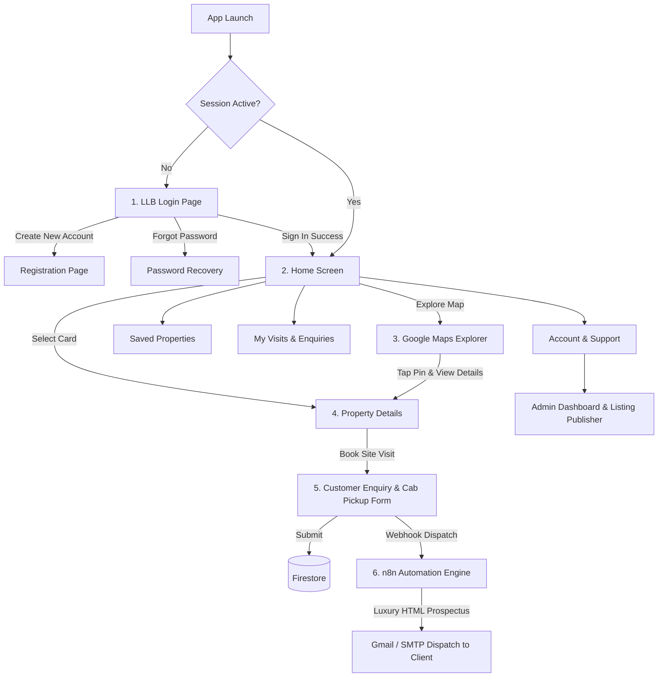

# LLB Real Estate — Mobile Application
### Lokesh Laven Barani Real Estate Company (Chennai, Tamil Nadu)

A complete, production-grade mobile application built with **Flutter & Dart** for Android and iOS, featuring:
- **Strict 90% White & 10% Black Minimalist Luxury Visual Design System**
- **First Screen Enforced as Login Screen** (restores session directly to Home when active)
- **Firebase Authentication** (Sign In, Create Account, Forgot Password)
- **Cloud Firestore & Firebase Cloud Storage** for CMDA & RERA property listings, user profiles, and enquiries
- **Firebase Cloud Functions** backend triggers for automated event processing
- **Google Maps SDK for Flutter** with custom property markers, locality filtering, and directions routing
- **n8n Workflow Automation** for dispatching branded HTML property prospectuses and live site visit confirmations via Gmail/SMTP
- **Riverpod State Management** and **GoRouter** declarative page routing

---

## 1. Design System (90% White / 10% Black)

The design adheres to a high-contrast luxury architectural aesthetic:
- **90% White (`#FFFFFF`, `#FAFAFA`)**: All backgrounds, property cards, bottom navigation bar, forms, sheets, and dialogs.
- **10% Black (`#000000`, `#09090B`)**: LLB Monogram logo badge, typography, primary action buttons, selected indicators, and borders.
- **Subtle Greys (`#E4E4E7`, `#71717A`)**: Used exclusively for 1px hairline dividers, unselected tabs, and secondary labels.
- **Photography & Google Maps**: Maintain their authentic natural colors.

---

## 2. Application Flow & Screen Hierarchy



---

## 3. Technology Stack & Key Dependencies

| Component | Technology | Purpose |
| :--- | :--- | :--- |
| **Mobile Framework** | Flutter 3.2.0+ (Dart) | Cross-platform Android & iOS |
| **State Management** | `flutter_riverpod: ^2.5.1` | Reactive state & dependency injection |
| **Navigation & Routing**| `go_router: ^14.1.4` | Declarative deep-linking & auth redirects |
| **Authentication** | `firebase_auth: ^4.19.4` | Email & password, password reset |
| **Database** | `cloud_firestore: ^4.17.2` | Properties, bookings, profiles |
| **Maps & Geolocation** | `google_maps_flutter: ^2.6.0` | Pinpoint property coordinates & directions |
| **Automation** | `n8n` Webhook & Gmail Node | Sends official CMDA prospectuses to customer |
| **Cloud Functions** | Node.js 18 (Firebase Admin) | Firestore triggers for webhook dispatch |

---

## 4. Visual Studio Code Setup & Development

This project includes pre-configured `.vscode/launch.json` and `.vscode/settings.json` configurations.

### Quick Start:
1. Open this directory in **Visual Studio Code**:
   ```powershell
   code "C:\Users\praba karan\.gemini\antigravity\scratch\llb_real_estate"
   ```
2. Fetch dependencies:
   ```bash
   flutter pub get
   ```
3. Run the application:
   - Press **F5** in VS Code, or
   - Select **LLB Real Estate (Debug)** from the Run & Debug sidebar, or run:
     ```bash
     flutter run
     ```

---

## 5. Google Maps & Firebase Configuration

### Google Maps API Key:
- **Android**: Set your key in `android/app/src/main/AndroidManifest.xml`:
  ```xml
  <meta-data
      android:name="com.google.android.geo.API_KEY"
      android:value="YOUR_GOOGLE_MAPS_API_KEY_HERE" />
  ```
- **iOS**: Ensure `Info.plist` contains your location descriptions (already pre-configured).

### Firebase Setup:
- Place `google-services.json` in `android/app/`.
- Place `GoogleService-Info.plist` in `ios/Runner/`.
> **Note:** The application includes a resilient built-in repository with verified Chennai listings (Anna Nagar, OMR, ECR, Porur, Velachery). Even before Firebase keys are provisioned, all UI flows, session login, booking, and n8n webhooks operate seamlessly.

---

## 6. n8n Automated Email Prospectus Setup

The workflow file `n8n-workflow-llb-real-estate.json` is included at the project root:
1. Open your n8n dashboard (cloud or self-hosted).
2. Go to **Workflows → Import from File** and select `n8n-workflow-llb-real-estate.json`.
3. Configure your **Gmail** or **SMTP** credential in the email node.
4. Activate the workflow. The webhook URL matches `AppConstants.n8nWebhookUrl` (`/webhook/llb-chennai-events`).
5. When a user books a site visit in the app, n8n immediately:
   - Parses client name, date, cab pickup address, and loan requirements.
   - Embeds high-resolution property photography, CMDA & RERA approval numbers, and groundwater depth.
   - Dispatches a personalized, monochromatic HTML email prospectus to the buyer's inbox.
